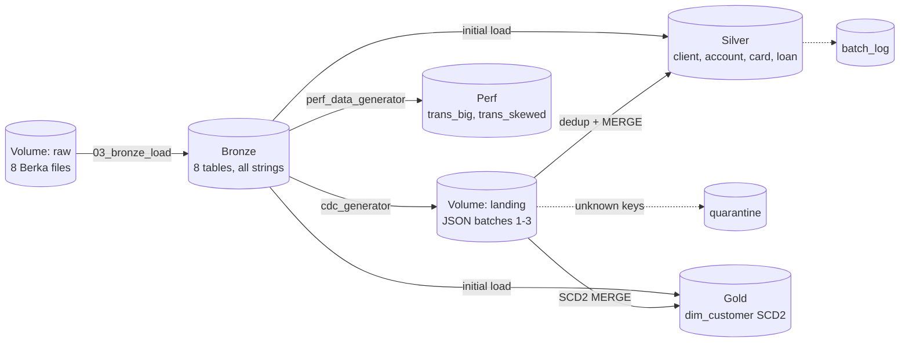

# Bank Customer History: CDC and SCD Type 2 on Databricks

An incremental data pipeline on **Databricks** and **Delta Lake** using the Berka banking dataset. Simulated change batches (inserts, updates, deletes) are applied to current-state silver tables with `MERGE`, customer history is kept in an **SCD Type 2** dimension, and a performance section compares join strategies on a 105.6M-row synthetic table.

Built on **Databricks Free Edition** (serverless compute, Unity Catalog).

## Highlights

- **CDC with `MERGE`:** monthly change batches (I / U / D) applied to 4 silver tables; in-batch deduplication, idempotent re-runs (batch log + row-level timestamp check) and a quarantine table for changes to unknown keys.
- **Delta Lake features:** `DESCRIBE HISTORY`, time travel, Change Data Feed and `RESTORE`, each checked against the pipeline's own batch log.
- **SCD Type 2 customer dimension:** staged union `MERGE`, hash-based change detection, IDENTITY surrogate key, point-in-time queries; 9 automated checks.
- **Performance tuning:** broadcast join is ~5× faster than shuffle (sort-merge) join on 105.6M rows; the effect of data skew is measured separately. Analysis with `EXPLAIN` and Query Profile.

## Tech stack

| Area | Tools |
|---|---|
| Platform | Databricks Free Edition (serverless), Unity Catalog, Git folders |
| Storage | Delta Lake (managed tables, volumes) |
| Processing | PySpark (DataFrame API), Spark SQL (`MERGE INTO`), Photon |
| Language | Python 3 |

## Architecture



| Layer | Content |
|---|---|
| Bronze | Raw Berka files as Delta tables; all columns kept as strings, plus `_ingest_ts` and `_source_file` |
| Landing | Simulated CDC batches: full row image + `op_type`, `change_ts`, `batch_id` (JSON lines) |
| Silver | Typed current-state tables updated with `MERGE`; `batch_log` and `quarantine` tables |
| Gold | `dim_customer`, SCD Type 2 |
| Perf | Synthetic large copies of `trans` for performance tests |

## Data

[Berka dataset](https://www.kaggle.com/datasets/marceloventura/the-berka-dataset) (PKDD'99): anonymized data of a Czech bank, 1993–1998. 8 tables (clients, accounts, cards, loans, ~1M transactions), ~1.08M rows in total. The data is not stored in this repository.

## CDC simulation

`src/cdc_generator.py` reads the bronze state and generates 3 monthly batches (January–March 1999, 150 records, seed 42). Each batch is generated from the state after the previous batch.

| Table | Changes |
|---|---|
| `client` | Address change (U), new customer (I) |
| `account` | Statement frequency change (U) |
| `card` | Upgrade to gold (U), cancellation (D), new card (I) |
| `loan` | Status change (U) |

Edge cases are added on purpose: the same key changed twice in one batch (U → U, I → U) and changes for keys that do not exist.

## Silver: incremental load with MERGE

For each table and batch (`src/silver_merge.py`):

1. Read the batch with an explicit schema.
2. Deduplicate: keep the latest `change_ts` per key (`ROW_NUMBER`). If a key was inserted and then updated in the same batch, it becomes a single insert with its latest values.
3. Cast to silver types.
4. Move U / D records for keys missing in the target to `quarantine`.
5. Apply `MERGE`:

| Clause | Condition | Action |
|---|---|---|
| `WHEN MATCHED` | `op_type = 'D'` | `DELETE` |
| `WHEN MATCHED` | `op_type = 'U'` and `change_ts > _change_ts` | `UPDATE` |
| `WHEN NOT MATCHED` | `op_type = 'I'` | `INSERT` |

**Idempotency (defense in depth):** `batch_log` skips batches already marked `SUCCESS`; the `_change_ts` condition stops an older record from overwriting a newer one, even without the log.

Final row counts after 3 batches: client 5,383, account 4,500, card 890, loan 682.

## Delta Lake features

`08_silver_history` works on the silver state after the batches:

- **`DESCRIBE HISTORY`:** `operationMetrics` of each `MERGE` match the counts in `batch_log` (12/12).
- **Time travel (`VERSION AS OF`):** card row count per version (892 → 890 → 893 → 890); a customer's address before and after a batch.
- **Change Data Feed:** cancelled cards are hard-deleted in silver but still visible in CDF. Landing records reconcile as `landing = CDF + quarantine + merged by dedup`.
- **`RESTORE`:** roll back to batch 1, then forward to the last `MERGE` version.

## Gold: SCD Type 2 customer dimension

`gold.dim_customer` starts from the bronze snapshot (one open version per customer). Each landing batch is applied with a **staged union `MERGE`**: a changed customer enters the source twice.

| `merge_key` | Matches the open row? | Result |
|---|---|---|
| `client_id` | Yes | Close the open row (`valid_to = change_ts`, `is_current = false`) |
| `NULL` | Never | Insert the new version |

- Change detection with `row_hash` (SHA-256 of the tracked columns).
- `customer_sk`: IDENTITY surrogate key.
- `valid_to` is exclusive: point-in-time query `valid_from <= ts AND ts < valid_to`.

Result: 5,415 rows, 5,383 current, 32 closed versions. Checks include one current row per customer, dimension = silver, and re-running a batch with and without the log (no changes).

## Performance tuning

**Synthetic data:** `trans` copied 100 times → 105.6M rows. IDs are shifted per copy and dates move 6 years per copy, so copies do not overlap (dates run to 2592; the data is synthetic). A second table adds skew: ~30% of the copied rows are moved to one account (~31M rows).

**Baseline (`11_perf_baseline`):** join, aggregation and date filter queries. No timing difference between the skewed and non-skewed tables: the join is a broadcast join, and the aggregation runs a partial aggregation before the shuffle.

**Join strategies (`12_perf_tuning`):** the same join with `BROADCAST` and `SHUFFLE_MERGE` hints on both tables.

| Hint | Time |
|---|---|
| `BROADCAST` | ~1 s |
| `SHUFFLE_MERGE` | ~6 s |

- Broadcast join is ~5× faster: no shuffle or sort on the large side, and the join stays in Photon.
- Photon does not support `SortMergeJoin`, so the shuffle join runs row-based (only about a quarter of the work in Photon).
- Skew adds less than 10% to the shuffle join; no AQE skew join was observed. The cost comes from shuffling and sorting 105.6M rows, not from skew.

Timings are rounded: they vary between runs on serverless compute.

## Repository structure

```
bank-customer-history-delta/
├── notebooks/
│   ├── 00_env_test.ipynb
│   ├── 01_setup_unity_catalog.ipynb
│   ├── 02_raw_data_check.ipynb
│   ├── 03_bronze_load.ipynb
│   ├── 04_cdc_generate.ipynb
│   ├── 05_silver_load.ipynb
│   ├── 06_silver_merge.ipynb
│   ├── 07_silver_merge_edge_cases.ipynb
│   ├── 08_silver_history.ipynb
│   ├── 09_gold_dim_customer.ipynb
│   ├── 10_perf_data_generator.ipynb
│   ├── 11_perf_baseline.ipynb
│   └── 12_perf_tuning.ipynb
├── src/
│   ├── cdc_generator.py
│   ├── silver_transforms.py
│   ├── silver_merge.py
│   ├── gold_dim_customer.py
│   └── perf_data_generator.py
├── tr/notebooks/        # Turkish copies of the notebooks (for reading)
└── README.md
```

## How to run

1. Add this repository to Databricks as a **Git folder**.
2. Run `01_setup_unity_catalog` (schemas `bronze`, `silver`, `gold` and volumes `raw`, `landing` under the `workspace` catalog).
3. Download the Berka files and upload the 8 `.csv` files to `/Volumes/workspace/bronze/raw/`.
4. Run the notebooks in order:

| Step | Notebooks |
|---|---|
| Bronze | `02` (optional checks) → `03` |
| CDC batches | `04` |
| Silver | `05` → `06` → `07` (resets silver and re-applies all batches with tests) → `08` |
| Gold | `09` |
| Performance | `10` → `11` → `12` (needs bronze and `silver.account`; `10` writes ~2 GB) |

Run the notebooks from `notebooks/`; the copies in `tr/notebooks/` are for reading only.

## Notes

- Card cancellation is a hard delete tracked with CDF to demonstrate `MERGE ... DELETE`; in a real system it would be a soft delete or an SCD2 change.
- After `RESTORE`, `batch_log` must also be updated; otherwise the rolled-back batch still shows `SUCCESS` and is not re-run.
- SCD2 granularity is one batch: intermediate changes inside a batch are not kept in the dimension.
- In the skewed performance table, balances of the hot account are not meaningful; the table is for performance tests only.
- Databricks Free Edition uses Spark Connect: no `sparkContext` or RDD API, only DataFrame API and Spark SQL.
