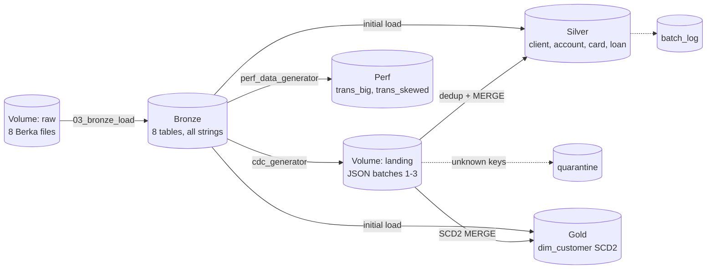

# Bank Customer History: CDC and SCD Type 2 on Databricks

An incremental data pipeline on **Databricks** and **Delta Lake** using the [Berka banking dataset](https://www.kaggle.com/datasets/marceloventura/the-berka-dataset) (Czech bank, 1993–1998, ~1.08M rows). Simulated change batches are applied to silver tables with `MERGE`, customer history is kept in an **SCD Type 2** dimension, and a performance section compares join strategies on 105.6M rows.

Stack: Databricks Free Edition (serverless), Unity Catalog, Delta Lake, PySpark, Spark SQL, Photon.

## Highlights

- **CDC with `MERGE`:** monthly change batches (insert / update / delete) applied to 4 silver tables; in-batch deduplication, idempotent re-runs and a quarantine table for unknown keys.
- **Delta Lake features:** `DESCRIBE HISTORY`, time travel, Change Data Feed and `RESTORE`, each checked against the pipeline's own batch log.
- **SCD Type 2 customer dimension:** staged union `MERGE`, hash-based change detection, IDENTITY surrogate key, point-in-time queries.
- **Performance tuning:** broadcast join ~5× faster than shuffle join on 105.6M rows; skew measured separately with `EXPLAIN` and Query Profile.

## Architecture

**CDC simulation.** `src/cdc_generator.py` generates 3 monthly batches (150 records, seed 42) from the bronze state: address changes and new customers, account frequency changes, card upgrades / cancellations / new cards, and loan status changes. Edge cases (the same key changed twice in a batch, changes for missing keys) are added on purpose.

**Silver.** Each batch is deduplicated (latest `change_ts` per key; insert + update in one batch becomes a single insert), cast to silver types and applied with `MERGE` (`DELETE` / `UPDATE` / `INSERT` by `op_type`). Changes for keys missing in the target go to `quarantine`. Re-runs are safe: `batch_log` skips finished batches, and a `_change_ts` condition stops older records from overwriting newer ones.

**Delta Lake.** `DESCRIBE HISTORY` metrics match `batch_log`, time travel shows each table version per batch, Change Data Feed keeps the hard-deleted cards, and landing records reconcile with CDF + quarantine + dedup. `RESTORE` rolls card back to batch 1 and forward again.

**Gold.** `dim_customer` starts from the bronze snapshot. A changed customer enters the `MERGE` source twice: one row closes the open version, the other inserts the new one. `row_hash` detects changes, `valid_to` is exclusive (`valid_from <= ts AND ts < valid_to`).

## Results

| Area | Result |
|---|---|
| Silver | client 5,383, account 4,500, card 890, loan 682 rows after 3 batches; history and CDF counts match `batch_log` |
| Idempotency | Re-running a batch: skipped by the log; without the log, 0 changes |
| Gold | 5,415 rows, 5,383 current, 32 closed versions; 9/9 checks pass |
| Baseline | No difference between skewed and non-skewed tables: broadcast join and partial aggregation neutralize skew |
| Join strategies | `BROADCAST` ~1 s, `SHUFFLE_MERGE` ~6 s (~5×); Photon does not support `SortMergeJoin`, so the shuffle join runs row-based |
| Skew | Adds less than 10% to the shuffle join; no AQE skew join observed |

Timings are rounded: they vary between runs on serverless compute.

## How to run

1. Add this repository to Databricks as a **Git folder**.
2. Run `01_setup_unity_catalog` (schemas and volumes under the `workspace` catalog).
3. Upload the 8 Berka `.csv` files to `/Volumes/workspace/bronze/raw/`.
4. Run the notebooks in `notebooks/`:

| Step | Notebooks |
|---|---|
| Bronze | `02` (optional checks) → `03` |
| CDC batches | `04` |
| Silver | `05` → `06` → `07` (resets silver, re-applies all batches, runs tests) → `08` |
| Gold | `09` |
| Performance | `10` → `11` → `12` (needs bronze and `silver.account`; `10` writes ~2 GB) |

Code is in `src/`; Turkish copies of the notebooks are in `tr/notebooks/` (for reading only).

## Notes

- Card cancellation is a hard delete tracked with CDF to demonstrate `MERGE ... DELETE`; a real system would use a soft delete or SCD2.
- After `RESTORE`, `batch_log` must also be updated, or the rolled-back batch will not be re-run.
- SCD2 granularity is one batch: intermediate changes inside a batch are not kept.
- Performance data is synthetic (`trans` × 100, dates shifted up to 2592); the skewed table is for performance tests only.
