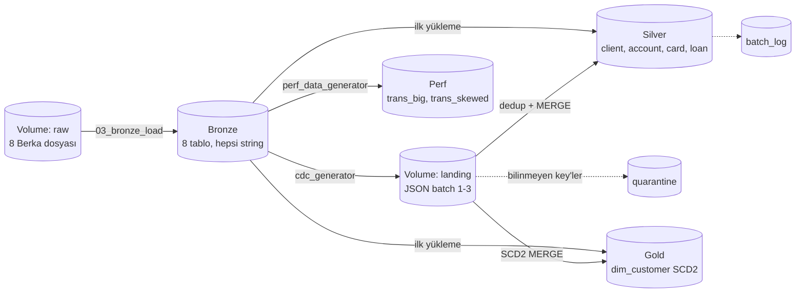

# Bank Customer History: Databricks üzerinde CDC ve SCD Type 2

**Databricks** ve **Delta Lake** üzerinde, [Berka bankacılık dataset'i](https://www.kaggle.com/datasets/marceloventura/the-berka-dataset) (Çek bankası, 1993–1998, ~1,08M satır) ile kurulmuş bir incremental data pipeline. Simüle edilen değişiklik batch'leri silver tablolara `MERGE` ile uygulanır, müşteri tarihçesi bir **SCD Type 2** dimension'da tutulur ve performans bölümünde 105,6M satır üzerinde join stratejileri karşılaştırılır.

Stack: Databricks Free Edition (serverless), Unity Catalog, Delta Lake, PySpark, Spark SQL, Photon.

> Ana README İngilizce: [../README.md](../README.md). Bu klasördeki notebook'lar `notebooks/`'un Türkçe kopyalarıdır ve sadece okuma amaçlıdır.

## Öne çıkanlar

- **`MERGE` ile CDC:** Aylık değişiklik batch'leri (insert / update / delete) 4 silver tabloya uygulanır; batch içi dedup, idempotent tekrar çalıştırma ve bilinmeyen key'ler için quarantine tablosu.
- **Delta Lake özellikleri:** `DESCRIBE HISTORY`, time travel, Change Data Feed ve `RESTORE`; her biri pipeline'ın kendi batch log'u ile doğrulanır.
- **SCD Type 2 müşteri dimension'ı:** Staged union `MERGE`, hash ile değişiklik tespiti, IDENTITY surrogate key, point-in-time sorgular.
- **Performance tuning:** 105,6M satırda broadcast join, shuffle join'den ~5 kat hızlı; skew etkisi ayrıca ölçülür. Analiz `EXPLAIN` ve Query Profile ile.

## Mimari

**CDC simülasyonu.** `src/cdc_generator.py` bronze state'inden 3 aylık batch üretir (150 kayıt, seed 42): adres değişiklikleri ve yeni müşteriler, hesap frequency değişiklikleri, kart yükseltme / iptal / yeni kart ve kredi status değişiklikleri. Edge case'ler bilerek eklenir: aynı key'in bir batch'te iki kez değişmesi, olmayan key'lere gelen değişiklikler.

**Silver.** Her batch dedup edilir (key başına en yeni `change_ts`; aynı batch'teki insert + update tek bir insert'e dönüşür), silver tiplerine çevrilir ve `MERGE` ile uygulanır (`op_type`'a göre `DELETE` / `UPDATE` / `INSERT`). Target'ta olmayan key'lere gelen değişiklikler `quarantine`'e gider. Tekrar çalıştırma güvenlidir: `batch_log` tamamlanmış batch'leri atlar, `_change_ts` koşulu eski kaydın yenisini ezmesini engeller.

**Delta Lake.** `DESCRIBE HISTORY` metrikleri `batch_log` ile birebir aynı, time travel her batch sonrası tablo version'ını gösterir, Change Data Feed hard delete edilen kartları tutar ve landing kayıtları CDF + quarantine + dedup ile birebir açıklanır. `RESTORE` card'ı batch 1'e geri alır, sonra tekrar ileri getirir.

**Gold.** `dim_customer` bronze snapshot'ından başlar. Değişen müşteri `MERGE` source'una iki kez girer: bir satır açık version'ı kapatır, diğeri yenisini insert eder. `row_hash` değişikliği tespit eder, `valid_to` exclusive'dir (`valid_from <= ts AND ts < valid_to`).

## Sonuçlar

| Alan | Sonuç |
|---|---|
| Silver | 3 batch sonrası client 5.383, account 4.500, card 890, loan 682 satır; history ve CDF sayıları `batch_log` ile aynı |
| Idempotency | Batch tekrarı: log tarafından atlanır; log olmadan da 0 değişiklik |
| Gold | 5.415 satır, 5.383 current, 32 kapanmış version; 9/9 kontrol geçti |
| Baseline | Skew'lü ve skew'süz tablolar arasında fark yok: broadcast join ve partial aggregation skew'ü nötralize ediyor |
| Join stratejileri | `BROADCAST` ~1 sn, `SHUFFLE_MERGE` ~6 sn (~5 kat); Photon `SortMergeJoin`'i desteklemediği için shuffle join row-based çalışıyor |
| Skew | Shuffle join'e %10'dan az ekliyor; AQE skew join gözlenmedi |

Süreler yuvarlaktır: serverless compute'ta run'dan run'a değişir.

## Nasıl çalıştırılır

1. Repo'yu Databricks'e **Git folder** olarak ekle.
2. `01_setup_unity_catalog`'u çalıştır (`workspace` catalog'u altında schema'lar ve volume'lar).
3. 8 Berka `.csv` dosyasını `/Volumes/workspace/bronze/raw/`'a yükle.
4. `notebooks/` altındaki notebook'ları çalıştır:

| Adım | Notebook'lar |
|---|---|
| Bronze | `02` (isteğe bağlı kontroller) → `03` |
| CDC batch'leri | `04` |
| Silver | `05` → `06` → `07` (silver'ı resetler, tüm batch'leri tekrar uygular, testleri çalıştırır) → `08` |
| Gold | `09` |
| Performans | `10` → `11` → `12` (bronze ve `silver.account` gerekli; `10` ~2 GB yazar) |

Kod `src/` altında. Notebook'lar `notebooks/` klasöründen çalıştırılır; `tr/notebooks/` içinden çalıştırılırsa `src` import'u kırılır.

## Notlar

- Kart iptali, `MERGE ... DELETE`'i göstermek için CDF ile izlenen bir hard delete; gerçek bir sistemde soft delete ya da SCD2 kullanılır.
- `RESTORE` sonrası `batch_log` da güncellenmeli; yoksa geri alınan batch tekrar çalıştırılmaz.
- SCD2 granularity bir batch: batch içindeki ara değişiklikler tutulmaz.
- Performans verisi sentetik (`trans` × 100, tarihler 2592'ye kadar kaydırılmış); skew'lü tablo sadece performans testi için.
